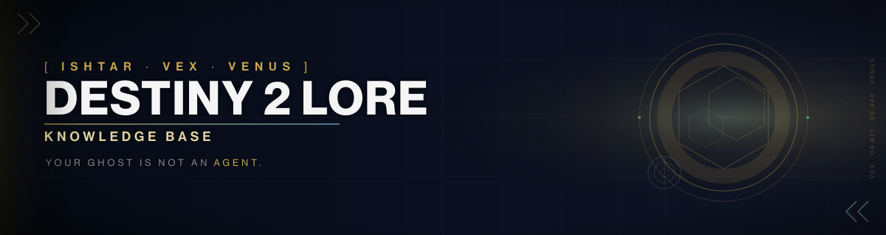

# Destiny 2 Lore Knowledge Base

  

**Version:** 0.2.1 | **Status:** Development

> ⚠️ **WARNING:** This repository is under heavy development while the knowledge base is being constructed. Expect frequent changes, incomplete data, and shifting structure. The author's prowess is not to be trusted with anything important. Use at your own risk.

A shared, indexed repository of Destiny 2 lore ingested from the Ishtar Collective.
Any agent (Drifter persona, lore research, etc.) may reference these files at will.

## Structure

- `index.md` - Master book list with ingestion status (pending/done/partial).
- `books/<slug>.md` - Full text of each ingested book, entries as `##` sections.
- `transcripts/<slug>.md` - Transcripts (quest dialogue) as ingested.

## How to use

1. Check `index.md` for a book's status and slug.
2. Read `books/<slug>.md` for the full lore text.
3. Entries within a book are separated by `## Entry Title` headers.

## Ingestion rules

- Only lore body text is kept - site navigation, headers, footers, category lists, timeline widgets, and "Discuss this transcript" links are stripped.
- If an entry cannot be fetched, the book is marked `partial` with a note; nothing is invented.
- Capitalization matters: "Guardian" (capitalized) generally refers to the player character.

## Source & Attributions

All content sourced from https://www.ishtar-collective.net (Ishtar Collective).
Book list mirrored from https://www.ishtar-collective.net/books.

Fan-made collection. Not affiliated with or endorsed by Bungie.

- **Destiny 2** - © Bungie, Inc. All lore, characters, locations are Bungie's property.
- **Ishtar Collective** (https://www.ishtar-collective.net) - Primary source for all ingested lore text.
- **Destiny Lore Vault** (YouTube) - Audio recordings of key transcripts.

All content sourced from publicly available Destiny 2 lore. No original creative content is claimed.

## Progress

109 / 109 books ingested. 68 transcripts ingested.
Last scrape: 2026-10-30. Content through Renegades (Dec 2025).
